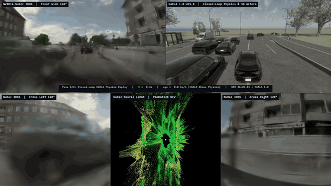

# City Sample → CARLA

Run Epic Games' **City Sample** (Unreal Engine 5.8) as a **CARLA 1.0** simulator — real city geometry, real CARLA traffic, and real CARLA sensors — or extract its road network as standalone ASAM OpenDRIVE.

[](https://doi.org/10.5281/zenodo.22306770)
[](LICENSE)


*Four synchronised CARLA 1.0 sensors on Epic's City Sample (`Big_City_LVL`): RGB, semantic segmentation, depth, and top-down LiDAR. Above: 5.5× time-lapse GIF (`9.05 MB`); full real-time 3-minute MP4 (`9.08 MB`): [docs/citysample-carla.mp4](docs/citysample-carla.mp4).*

---

## Two Ways to Use This Repo

You can stop after Part A if you only need the road network, or continue through Part B to serve the full Unreal city in CARLA 1.0:

| Workflow | What you get | Requirements |
|---|---|---|
| **[Part A — Road network](#2-part-a--extract-the-road-network)** | `Small_City_LVL` and `Big_City_LVL` exported as ASAM **OpenDRIVE** (`.xodr`) with signals, signs, speed limits, and crosswalks. Runs in any CARLA (`generate_opendrive_world`). | Stock UE 5.8 + City Sample + Python 3.10+ |
| **[Part B — Full city server](#3-part-b--run-city-sample-as-a-carla-10-server)** | CARLA 1.0 serving the City Sample levels directly — Nanite/Lumen buildings, props, Mass traffic & crowd, pedestrian navmeshes, and full sensor suite. | Also needs CARLA 1.0 + CARLA's UE 5.8 fork built from source (~385 GB disk, 64 GB RAM) |

### Supported Maps (CARLA 1.0, `v1.1.0`)

| Map | Footprint | Roads & Junctions | Signals & Curbside Signs | Pedestrian NavMesh |
|---|---|---|---|---|
| **`Small_City_LVL`** | `1.66 × 1.30 km` (`145 km` lanes) | `3,497` roads · `172` junctions (`4,672` spawns) | `355` lights · `193` stop · `2` yield · `197` speed (`30–90 km/h`) · `1,096` crosswalks | `620` tiles (`5.7 MB`) from `7,846` ZoneGraph pedestrian lanes |
| **`Big_City_LVL`** | `4.16 × 4.99 km` (`1,197.5 km` lanes) | `23,594` roads · `1,236` junctions (`33,590` spawns) | `2,176` lights · `2,107` stop · `7` yield · `1,356` speed (`30–90 km/h`) · `8,310` crosswalks | `5,591` tiles (`45.8 MB`) from `59,384` ZoneGraph pedestrian lanes |

> ### Quick Notes Before Collecting Data
>
> - **Works out of the box**: RGB, depth, GNSS, IMU, collision sensors, vehicle control, **camera semantic segmentation** (`0.2 %` unlabeled on `Small_City_LVL`, `0.4 %` on `Big_City_LVL`, `Sky` = `11`), **semantic & plain LiDAR** (`1.26 %` unlabeled, `0` ego self-hits), **radar**, `ground_projection`, `cast_ray`, phased traffic lights, stop/yield/speed-limit signs (`0` poles in driving lanes), and crosswalks. (`carla.FastGeoTagger.Enable` defaults to `1`; set `0` if you do not use semantic sensors.)
> - **Two opt-in additions**:
>   - Pass `-ExecCmds "carla.MassBridge.Enable 1"` to mirror Epic's ambient **Mass traffic and crowd** (`150` vehicles + `100` walkers nearest `role_name="hero"` or the spectator) into `world.get_actors()` alongside CARLA's Traffic Manager (§3 Step 6).
>   - Build & install the **Recast navmesh** (`Content\Map\Nav\<Map>.bin`) to enable CARLA walkers and `get_random_location_from_navigation()` (§3 Step 3).
> - **Caveats**: Discard the very first semantic frame while World Partition finishes initial streaming (~25 s); speed/yield signs are inferred from ZoneGraph metadata; and mirrored Mass vehicles are read-only. See **[Known Limitations](#8-known-limitations)** and **[docs/KNOWN-LIMITATIONS.md](docs/KNOWN-LIMITATIONS.md)**.

---

## 1. Prerequisites

| Requirement | Part A | Part B |
|---|:--:|:--:|
| **City Sample** (free on Fab → add to library → create project) | ● | ● |
| **Visual Studio 2022** (or Build Tools) with **C++ x64** + **.NET Framework 4.8 SDK** (`tools/Install-NetFxSdk.ps1`) | ● | ● |
| **Python 3.10+** | ● | ● |
| **Unreal Engine 5.8** (Epic Games Launcher) | ● | |
| **CARLA Python package** (`pip install carla`, optional — only to test `.xodr` in stock CARLA) | ● | |
| **CARLA 1.0 built from source** + **CARLA's UE 5.8 fork** (requires an Epic-linked GitHub account) | | ● |
| ~**385 GB** free disk & ~**64 GB** RAM | | ● |

Run the prerequisite checker before starting:

```bash
python tools/doctor.py            # checks full Part B requirements
python tools/doctor.py --part-a   # checks Part A only
```

---

## 2. Part A — Extract the Road Network

### Step 1 — Build the ZoneGraph export plugin (once)

Copy `CityRoadExport/` into `<CitySample>/Plugins/CityRoadExport/`, then build the editor target:

```bash
"C:\Program Files\Epic Games\UE_5.8\Engine\Build\BatchFiles\Build.bat" CitySampleEditor Win64 DebugGame -Project="<CitySample>\CitySample.uproject"
```

### Step 2 — Export Epic's ZoneGraph

```bash
"C:\Program Files\Epic Games\UE_5.8\Engine\Binaries\Win64\UnrealEditor-Win64-DebugGame-Cmd.exe" "<CitySample>\CitySample.uproject" -run=ExportZoneGraph -Map=/Game/Map/Small_City_LVL -Out="C:\full\path\to\zonegraph.json" -unattended -nosound -nullrhi
```

- Always pass an **absolute path** to `-Out=` (Unreal sets its working directory to `Engine\Binaries\Win64`).
- Pass `-Map=/Game/Map/Big_City_LVL` to export Big City instead (`91,288` lanes, ~362 MB JSON vs. ~50 MB for Small City).

### Step 3 — Convert to OpenDRIVE and add signals & signs

```bash
# 1. Lanes -> road network -> OpenDRIVE 1.4 (with road-class speed limits & crosswalks)
python tools/zonegraph_to_roadnetwork.py zonegraph.json -o roadnetwork.json
python tools/roadnetwork_to_xodr.py roadnetwork.json -o SmallCity.xodr

# 2. Extract Epic's authored traffic lights and add stop, yield & US MUTCD speed-limit signs
python tools/masstraffic_lights_to_json.py "<CitySample>/Content/AI/Traffic/TrafficLights/CitySampleSmallCityTrafficLights.uasset" -o lights.json
python tools/add_signals_to_xodr.py SmallCity.xodr lights.json -o SmallCity-signals.xodr
```

*(For `Big_City_LVL`, pass `CitySampleBigCityTrafficLights.uasset` and write `BigCity-signals.xodr`.)*

### Step 4 — Plot or drive in any CARLA

```bash
python tools/plot_xodr.py SmallCity-signals.xodr -o SmallCity.png   # offline PNG plot
python tools/carla_validate_xodr.py SmallCity-signals.xodr          # test routing on a running CARLA server
```

---

## 3. Part B — Run City Sample as a CARLA 1.0 Server

Build against the pinned **CARLA 1.0** release revisions:
- **CARLA source**: tag [`1.0`](https://github.com/carla-simulator/carla/releases/tag/1.0) (`3ea166118d2c`)
- **CARLA UE 5.8 fork**: tag `1.0` (`b76fce0e3bcb`) — build per CARLA's [Windows UE5 build guide](https://github.com/carla-simulator/carla/blob/1.0/Docs/build_windows_ue5.md)
- **CARLA content**: commit [`55228c1ccca1`](https://bitbucket.org/carla-simulator/carla-content/commits/55228c1ccca1b698e5ad8c638c576d523bcdebb9)

Set these environment variables once per PowerShell session so every script finds your trees automatically:

```powershell
$env:CARLA_DIR      = "C:\carla-ue58\carla"                                     # CARLA 1.0 source checkout
$env:CARLA_UE_DIR   = "C:\carla-ue58\UnrealEngine5_carla"                       # Built CARLA fork of UE 5.8
$env:CITYSAMPLE_DIR = "$env:USERPROFILE\Documents\Unreal Projects\CitySample"   # City Sample project
```

### Step 1 — Fetch minimal CARLA content (skips 91% of unused town assets)

Run from **Git Bash**:

```bash
bash tools/fetch-carla-content.sh
```

Checks out the required CARLA blueprints, materials, props, and vehicle/walker assets (~46 GiB working tree instead of the full 513k-file LFS repository; set `LFS_CACHE` to place Git LFS cache on another drive).

### Step 2 — Build CARLA C++ and the Python wheel

Run from **this repository**:

```bash
SetupWithBuildTools.bat --skip-content
```

Builds LibCarla, `RecastBuilder.exe`, the Unreal plugin configuration, and the CARLA 1.0 Python wheel under `%CARLA_DIR%\Build\PythonAPI\dist\` (works with either VS 2022 Build Tools or the full IDE). Install the built `.whl` into your Python virtual environment.

### Step 3 — Build the pedestrian navmesh (recommended)

Mesh Epic's measured ZoneGraph pedestrian lanes (`--zonegraph`) together with the OpenDRIVE roads and crosswalks, then build the Recast `.bin`:

```bash
python tools/xodr_to_recast_obj.py SmallCity-signals.xodr --zonegraph zonegraph.json -o SmallCity.obj
"%CARLA_DIR%\Build\_deps\recastnavigation-build\RecastBuilder\RecastBuilder.exe" SmallCity.obj 0.3
```

*(Repeat with `BigCity-signals.xodr` and Big City's `zonegraph.json` -> `BigCity.obj` -> `BigCity.bin` if using `Big_City_LVL`.)*

### Step 4 — Integrate CARLA into the City Sample project

Close Unreal Editor if running, then run:

```powershell
powershell -File tools\Integrate-CarlaIntoCitySample.ps1
```

This applies `patches/carla-1.0-citysample.patch` to `$CARLA_DIR`, copies the CARLA plugins and `plugins/CarlaMassBridge` into the City Sample project, junctions `Content/Carla`, configures collision channels and tagger rules, and installs `SmallCity-signals.xodr` / `SmallCity.bin` (and `BigCity-signals.xodr` / `BigCity.bin` when present in the repo root or passed via `-BigCityOpenDrive` / `-BigCityNavMesh`).

- Dry-run check without modifying files: `-CheckOnly`
- Revert the City Sample project to its backed-up state: `-Undo` (add `-RevertCarlaPatch` to also unpatch `$CARLA_DIR`, and `-RemoveEngineRegistration` to remove the `HKCU` Unreal Engine entry)

### Step 5 — Build and launch the server

```powershell
powershell -File tools\Build-CarlaCity.ps1
powershell -File tools\Run-CarlaCity.ps1                     # Small_City_LVL (default)
powershell -File tools\Run-CarlaCity.ps1 -Map Big_City_LVL   # Big_City_LVL
```

> **First launch note:** A cold Derived Data Cache takes **1–2 hours** while Unreal compiles City Sample's Nanite meshes, shaders, and 8K textures (~75 GB of DDC/Intermediate output). Warm launches take **~60–80 s** on `Small_City_LVL` and **~3–5 min** to first tick on `Big_City_LVL`.

### Step 6 — Verify and configure runtime options

```bash
python tools/carla_probe.py --shots 4 --traffic 60         # map topology, RGB shots, Traffic Manager survival
python tools/verify_sensors.py                             # semantic & plain LiDAR, radar, raytracer, segmentation
python tools/carla_traffic_lights.py --watch 32            # lights, stop/yield/speed signs, phase cycling
python tools/segmentation_census.py --settle 25            # semantic segmentation census (settles at 0.0%–0.4% Unlabeled)
python tools/carla_mass_bridge.py --test-yielding          # Mass ECS proxies + two-way Mass <-> CARLA braking
python tools/carla_walkers.py --walkers 30                 # navmesh spawning & pedestrian movement
```

Useful server flags (`Run-CarlaCity.ps1`):

| Option / CVar | Default | Purpose |
|---|---|---|
| `-Map Big_City_LVL` | `Small_City_LVL` | Serve the full `4.16 × 4.99 km` city instead of Small City |
| `-Quality Medium` (or `Low`) | `Epic` | Lower UE5 scalability to raise FPS with multi-camera rigs |
| `-RenderOffScreen` | off | Headless off-screen rendering |
| `-ExecCmds "carla.MassBridge.Enable 1"` | `0` | Mirror Epic's nearest 150 Mass vehicles + 100 walkers into `world.get_actors()` |
| `carla.MassBridge.FollowHero` | `1` | Center mirrored Mass proxies on `role_name="hero"` (falls back to spectator) |
| `carla.MassBridge.ExportCarlaObstacles` | `1` | Publish CARLA vehicles & walkers as `FMassTrafficObstacleTag` entities so MassTraffic brakes for them |
| `carla.MassBridge.DisableMassTraffic` | `0` | Despawn ambient MassTraffic & parked vehicles from `-ExecCmds` (keeps traffic-light visuals) |
| `carla.MassBridge.DisableMassCrowd` | `0` | Despawn ambient MassCrowd pedestrians from `-ExecCmds` |
| `carla.FastGeoTagger.Enable` | `1` | Semantic segmentation & semantic LiDAR tagging for `FastGeoStreaming` geometry |
| `carla.Streaming.HeroRadiusCm` | engine default | Override the hero vehicle's World Partition streaming radius (or set `world_settings.tile_stream_distance` live from Python) |

*(Note: pass multiple `-ExecCmds` separated by commas in PowerShell, e.g. `-ExecCmds "carla.MassBridge.Enable 1","carla.Streaming.HeroRadiusCm 60000"`.)*

---

## 4. NVIDIA NuRec Photorealism (CARLA 1.0)

CARLA 1.0 includes native support (`PythonAPI/examples/nvidia/nurec`) for **NVIDIA Omniverse NuRec** (`nvcr.io/nvidia/nre/nre-ga:26.04.01`), combining CARLA's OpenDRIVE road collision, Chaos vehicle physics, and Traffic Manager with 3D Gaussian Ray Tracing (`3dgut-nrend`) over gRPC.



*CARLA 1.0 driving a reconstructed urban corridor with NVIDIA NuRec (`NRE 26.04.01`, `3dgut-nrend`): synchronized `120°` f-theta neural cameras, a `PANDAR128` neural LiDAR bird's-eye view (`~459k` points/sweep), and CARLA 1.0's UE 5.8 closed-loop physics view — first on the nominal trajectory, then with a `+1.8 m` counterfactual lane shift and CARLA Traffic Manager-controlled 3DGS traffic. Full MP4 (`8.12 MB`): [docs/citysample-carla-nurec.mp4](docs/citysample-carla-nurec.mp4).*

To run against the CARLA 1.0 server and Python wheel built in §3:

```bash
# 1. Start the NRE 26.04.01 gRPC server (Linux or WSL2 with NVIDIA Container Toolkit)
docker run --rm --gpus all -p 46435:46435 -v /path/to/scenes:/scenes:ro \
  nvcr.io/nvidia/nre/nre-ga:26.04.01 serve-grpc \
  --artifact-glob /scenes/<scene>.usdz --port=46435 --host=0.0.0.0 --enable-editing-actors

# 2. Run CARLA's NuRec client against your running CARLA 1.0 server
python %CARLA_DIR%/PythonAPI/examples/nvidia/nurec/nurec_runner.py --port 2000 --nurec-port 46435 -u <scene>.usdz
```

---

## 5. Measured Validation (`v1.1.0` on CARLA 1.0)

All figures below were measured on the live CARLA `1.0` server (`3ea166118d2c` / UE 5.8 `b76fce0e3bcb`) with `FastGeoTagger` on by default and `MassBridge` enabled:

| Check | Tool | `Small_City_LVL` | `Big_City_LVL` |
|---|---|---|---|
| **Multi-Lane Routing & Crosswalks** | `carla_probe.py` | `2,981` roads (`236` multi-lane · `23,536` lane-change wps) · `1,096` crosswalks (`0.00 m` err) · `200/200` 500 m drives | `21,712` roads (`1,312` multi-lane · `158,358` lane-change wps) · `8,310` crosswalks (`0.00 m` err) · `200/200` 500 m drives |
| **Traffic Manager + Two-Way Mass** | `carla_mass_bridge.py` | Live TM mid-block lane changes (`-1 -> -2`) · Mass brakes `17.9 -> 0.1 km/h` behind `hero` · `39/39` TM cars alive + `250` Mass proxies | Live TM mid-block lane changes (`-1 -> -2`) · Mass brakes `50.2 -> 0.0 km/h` behind `hero` · up to **`79 km/h`** on freeways + `250` Mass proxies |
| **Signals & Curbside Signs** | `carla_traffic_lights.py` | `355` lights (`106` groups cycling) · `193` stop · `2` yield · `197` speed (`30 -> 50 km/h` live trigger) · `0` lane overlaps | `2,176` lights (`619` groups cycling) · `2,109` stop · `7` yield · `1,357` speed (`30 -> 50 km/h` live trigger) · `0` lane overlaps |
| **Camera Segmentation** | `segmentation_census.py` | **`0.0 %–0.2 %` `Unlabeled`** (`Sky` = `11`, `0.00 %` `R > 29` from Run 1) | **`0.4 %` `Unlabeled`** settled at `(0, 0)` (`6.7 %` `Sky`, `0.00 %` `R > 29` from Run 1) |
| **LiDAR, Radar & Ray Queries** | `verify_sensors.py` | Semantic LiDAR `273,276` pts (**`1.49 %` `Unlabeled`**), `284,964` ego-attached (`0` self-hits), radar `2,674`, `cast_ray` + `ground_projection` **PASS** | Semantic LiDAR `204,168` pts (**`1.26 %` `Unlabeled`**), `237,792` ego-attached (`0` self-hits), radar `2,941`, `cast_ray` + `ground_projection` **PASS** |
| **Pedestrians (Measured Sidewalks)** | `carla_walkers.py` | `1` walkable island (`100 %`) · `20/20` random nav points · **`30/30` walkers moving** (median `21.0 m`) | `1` walkable island (`100 %`) · `20/20` random nav points · **`30/30` walkers moving** (median `21.1 m`) |

---

## 6. How It Works & Repository Layout

```
CityRoadExport (-run=ExportZoneGraph)
   └──► zonegraph.json
           ├──► zonegraph_to_roadnetwork.py ──► roadnetwork_to_xodr.py ──► add_signals_to_xodr.py ──► Saved/OpenDrive/<Map>.xodr
           └──► xodr_to_recast_obj.py --zonegraph ──► RecastBuilder.exe ────────────────────────────► Content/Map/Nav/<Map>.bin
```

- **Road semantics stay in Python**: The C++ `CityRoadExport` commandlet only serializes Epic's `FZoneGraphStorage` (which is not exposed to UE Python). Every conversion stage in `tools/` has `--selftest` and needs no C++ rebuild to iterate.
- **`CarlaMassBridge` (`plugins/CarlaMassBridge/`)**: Contains both the Mass ECS → CARLA dormant-actor bridge and the `FastGeoStreaming` semantic tagger (`FObjectKey`-memoized).
- **Where to edit**: `Integrate-CarlaIntoCitySample.ps1` copies plugins into `<CitySample>/Plugins/`. Always edit `plugins/CarlaMassBridge/` here or C++ files in `$CARLA_DIR` (regenerating `patches/carla-1.0-citysample.patch`), then re-integrate and rebuild — never edit `<CitySample>/Plugins/` directly.

```
CityRoadExport/             UE 5.8 commandlet plugin (-run=ExportZoneGraph)
plugins/CarlaMassBridge/    Mass -> CARLA actor bridge + FastGeo semantic tagger
patches/                    CARLA 1.0 patch (carla-1.0-citysample.patch) + legacy 0.10 patch
config/                     [CarlaTagger] asset-path semantic label rules
tools/                      Python converters ([--selftest]), verification clients, and PowerShell build/run drivers
docs/
  KNOWN-LIMITATIONS.md      Active caveats, engineering notes, and resolved-bug summary
  IMPLEMENTATION-PLAN.md    Stage-by-stage architecture and design record
  citysample-carla.*        3-minute 4-sensor Big_City_LVL showcase (<10 MB MP4 & GIF)
  citysample-carla-nurec.*  CARLA 1.0 + NVIDIA NuRec 3DGUT showcase (<10 MB MP4 & GIF)
ISSUES-TO-FILE.md           13 reproducible upstream CARLA issues (12 filed + 4 fix PRs on carla-simulator/carla)
```

---

## 7. Troubleshooting

| Symptom | Cause & Fix |
|---|---|
| Scene renders **blinding white** | CARLA's weather directional light competes with City Sample's sun. Set `weather.sun_altitude_angle = -90.0` (done automatically by `carla_probe.py` and `record_carla.py`). |
| `world.get_map()` → **`failed to generate map`** | Missing `Saved\OpenDrive\<MapName>.xodr`. Run Part A + `Integrate-CarlaIntoCitySample.ps1`. |
| `get_world()` **times out** right after port opens | Unreal is still compiling DDC assets or streaming initial World Partition cells. Watch `logs/run-carlacity.log` until steady ticks begin. |
| Startup **access violation** in `PreInitPostStartupScreen` | Unpatched CARLA CDO constructors loading `/Game/` assets too early. Run `Integrate-CarlaIntoCitySample.ps1` so `patches/carla-1.0-citysample.patch` is applied, then rebuild. |
| Editor hangs at **0 % CPU** on launch | Live Coding deadlocks when stdout is redirected; use `Run-CarlaCity.ps1` (passes `-NoLiveCoding`). |
| `Could not find vcvars64.bat` / `Could not find NetFxSDK` | Use `SetupWithBuildTools.bat` instead of `CarlaSetup.bat`, and run `tools/Install-NetFxSdk.ps1` if `.NET Framework 4.8 SDK` is missing. |
| Disk fills during content clone | Cloning all 513k LFS files instead of sparse content. Use `bash tools/fetch-carla-content.sh`. |
| External client (e.g. Carlamayo) reloads `Town10HD` over the city | Set the client's map name to `"Small_City_LVL"` or `"Big_City_LVL"` so its `map_name in current_map` check attaches to `Map/<MapName>` without calling `load_world()`. |

---

## 8. Known Limitations

Remaining architectural caveats are summarized below and documented in detail in **[docs/KNOWN-LIMITATIONS.md](docs/KNOWN-LIMITATIONS.md)** (upstream CARLA bugs and open pull requests are tracked in **[ISSUES-TO-FILE.md](ISSUES-TO-FILE.md)**):

- **World Partition streaming horizon**: `cast_ray()`, `ground_projection()`, and detailed semantic labels apply inside the active World Partition streaming radius around `role_name="hero"` / spectator (`carla.Streaming.HeroRadiusCm` / `world_settings.tile_stream_distance`); unstreamed distant HLODs render cleanly as `Unlabeled (0)` (`0.00 %` invalid IDs) until cells finish streaming (~20–25 s).
- **Read-only Mass ECS proxies**: Mirrored Mass proxies (`150` vehicles, `100` walkers around `hero`) participate in **two-way** obstacle yielding with CARLA vehicles/walkers (`carla.MassBridge.ExportCarlaObstacles 1`), and ambient Mass traffic/crowd can be turned off via `carla.MassBridge.DisableMassTraffic 1` / `DisableMassCrowd 1`, but individual `.mass.` entities cannot be steered via `apply_control()`.
- **Derived speed/yield signs vs. visual street art**: Functional `30–90 km/h` speed-limit and yield sign actors are derived from Epic's ZoneGraph road-class tags and merge geometry; City Sample's static street art does not include matching painted speed plates.
- **Diverging flares & junction lanes**: Co-parallel same-direction carriageways are grouped into multi-lane OpenDRIVE `<road>`s supporting mid-block lane changes, while ramp tapers, turn-pocket flares (`> 15 cm` offset delta), and junction connecting lanes stay single-lane `<road>`s so road meshes never overlap.

---

## 9. Citation & License

### Citing

[](https://doi.org/10.5281/zenodo.22306770)

```
Colley, M. citysample-carla: running Epic's City Sample as a CARLA simulator.
Zenodo. https://doi.org/10.5281/zenodo.22306770
```

`10.5281/zenodo.22306770` is the concept DOI (resolves to the latest release); version-specific DOIs and metadata are in [CITATION.cff](CITATION.cff).

### License

- **This repository** (`CityRoadExport/`, `plugins/CarlaMassBridge/`, `tools/`, `patches/`, `config/`, and documentation) is released under the **[MIT License](LICENSE)** and contains no Epic Games content.
- **City Sample and Unreal Engine** are obtained separately from Epic Games under the Unreal Engine EULA / Epic Content License. Files generated from your local City Sample installation (`zonegraph*.json`, `roadnetwork*.json`, `lights*.json`, `*.xodr`, `*.obj`, `*.bin`) are derived from Epic's content and are **not redistributed** here — regenerate them locally with the tools in `tools/`, and check Epic's license terms for your intended use.
- **CARLA** is MIT-licensed; the NuRec showcase clip (`docs/citysample-carla-nurec.*`) is rendered from CC-BY-4.0 PhysicalAI NuRec data and contains no Epic content.
